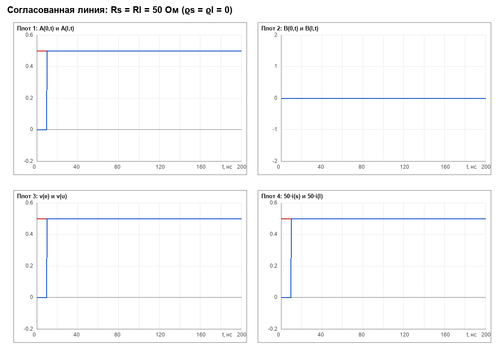
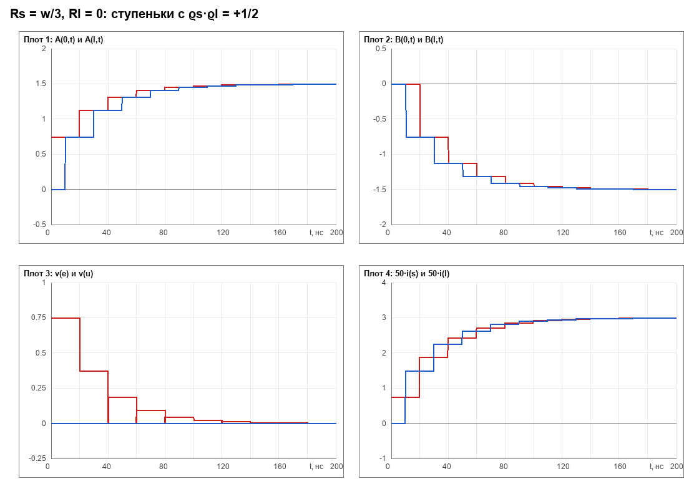
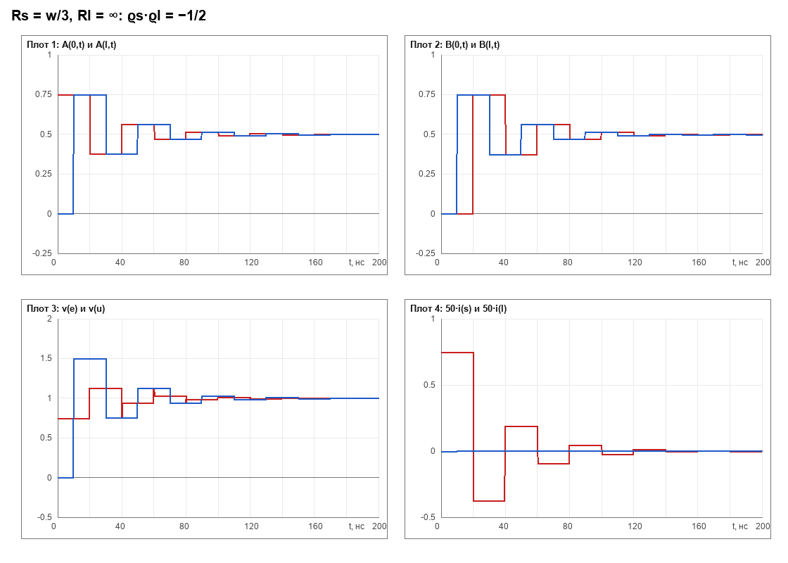
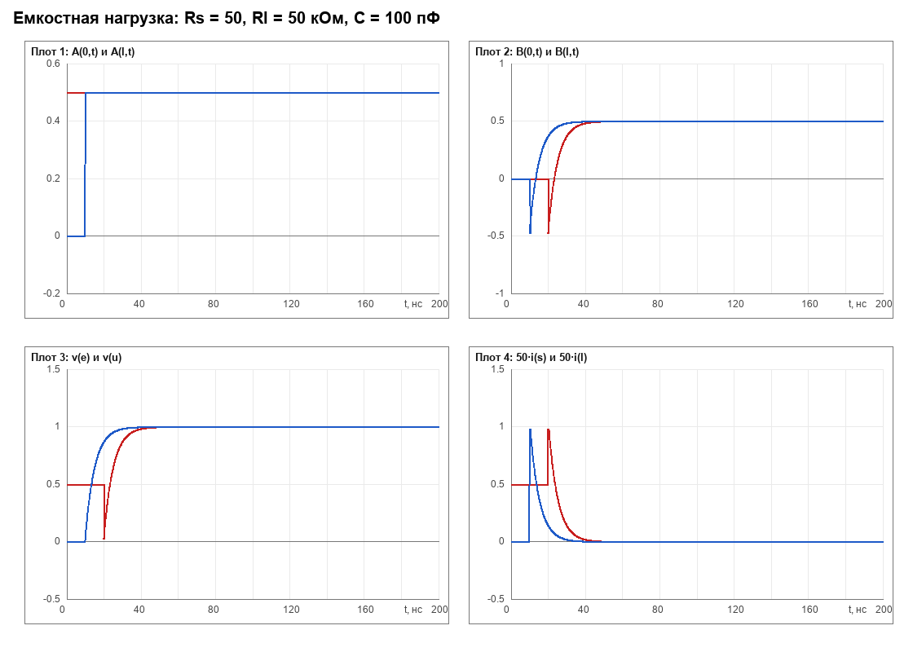

# ДЛИННЫЕ ЛИНИИ

*Лабораторная работа № 23*

*Методические указания МФТИ · курс «Радиотехнические цепи и сигналы»*

**Разбор для преподавателя-семинариста.** Текст методички — своими словами, с выводами, числовыми примерами, планом семинара на 90 минут и таблицей ожидаемых результатов в Micro-Cap.

> **Главное, что стоит понять до занятия**
>
> Вся лабораторная — про одно: **напряжение и ток в линии можно разложить на две бегущие волны**, падающую и отражённую. Как только вы это увидели, все 12 глав методички становятся следствиями двух формул:
> U = A + B и w·I = A − B.
> Источник рождает волну A, нагрузка отражает её с коэффициентом ρ, линия задерживает на τ и ослабляет в e−βl. Больше в линии ничего не происходит.

**Что внутри.** Главы 1–12 в том же порядке, что в методичке, — чтобы можно было читать с методичкой параллельно. Плюс: план занятия, числовые примеры «на салфетке», разбор задания 12.1 (измерения) и 12.2 (Micro-Cap) с таблицей всех ожидаемых цифр, шпаргалка формул и 20 вопросов с ответами для контроля понимания.

**Пометки по тексту.** «**На доске**» — что имеет смысл нарисовать руками. «**⚠ Ловушка**» — место, где студенты ошибаются чаще всего. «**Заметка**» — аккуратность формулировок, о которую можно споткнуться.

---

## Содержание

- **0. Как устроено занятие**
  - План на 90 минут
  - Пять идей, которые надо унести с семинара
- **Глава 1 Зачем вообще длинная линия**
  - Два числа, которые всё решают
  - Четыре погонных параметра
- **Глава 2 Телеграфные уравнения**
  - Вывод: вырезаем кусочек dx
  - Как прочитать их «по-русски»
  - Предельный случай: короткая линия
- **Глава 3 Волновые параметры: v, w, β и волны A, B**
  - Откуда берутся v и w
  - Условие Хевисайда: линия без дисперсии
  - Главный ход: расщепление на волны
  - Что означают A и B физически
  - Числовой пример на всё это
- **Глава 4 Гармонические волны: γ, k, λ и мощность**
  - Что получается
  - Волновое число, длина волны, частота
  - Мощность: почему в формуле стоит ½
  - Амплитуды мощности (микроволновая привычка)
  - Два описания одного и того же
- **Глава 5 Коэффициент отражения**
  - Отображение Z-плоскости на круг
  - Две полезные операции
  - Где это пригодится дальше
- **Глава 6 Стоячая волна**
  - Картинка двумя векторами
  - КСВ — коэффициент стоячей волны
  - Три вещи, которые студенты путают
- **Глава 7 Нагруженная линия**
  - Граничное условие на нагрузке
  - Входной импеданс
  - Четыре режима, которые надо знать наизусть
  - Четвертьволновой трансформатор
  - Четвертьволновой резонатор
  - Зачем резонатор в этой лабораторной
- **Глава 8 Подключаем источник**
  - Шаг 1: линия нулевой длины
  - Шаг 2: настоящая линия
  - Один важный вывод про мощность
- **Глава 9 Переходные процессы**
  - Откуда берётся прогрессия
  - Блок распространения = задержка + ослабление
  - Как выглядят ступеньки
  - Простые частные случаи, которые надо проговорить
- **Глава 10 Ёмкостная нагрузка**
  - Отражение от конденсатора — это фильтр
  - Переходная характеристика
  - Что видно на осциллографе
  - Предельные случаи
- **Глава 11 Матрица рассеяния**
  - Почему не h-параметры
  - Как их измеряют
  - S-матрица длинной линии
  - Вся теория в одну строчку
- **Глава 12.1 Задание 12.1: измерение параметров линии**
  - Пункт 1. Длина
  - Пункт 2. Два входных импеданса
  - Почему нужны два канала и поправка
  - Пункт 3. Волновое сопротивление, скорость, L и C
  - Пункт 4. Резонанс: R₀ и полоса
  - Пункт 5. Потери и добротность
  - Числовой пример — от начала до конца
- **Глава 12.2 Задание 12.2: переходные процессы в Micro-Cap**
  - Что находится в файле TLine.cir
  - Что должно получиться: таблица всех опытов
  - Опыт 1. Согласованная линия (Rs = Rl = 50)
  - Опыт 2. Рассогласованный источник (Rs = w/3)
  - Опыт 3. Рассогласованная нагрузка
  - Опыт 4. Рассогласованы оба конца — ступеньки
  - Опыт 4 (продолжение). Предельные случаи и расходимость
  - Опыт 5. Ёмкостная нагрузка
- **Шпаргалка: всё на одной странице**
- **20 вопросов студентам (с ответами)**
- **Десять ошибок, которые ловятся на раз**
- **Что ещё можно показать на семинаре**
    - 1. Верёвка вместо кабеля
    - 2. Две катушки на осциллографе
    - 3. Простой численный эксперимент

---

## 0. Как устроено занятие

Два дня — это много, если не пытаться выучить методичку наизусть. Достаточно взять из неё три вещи: **телеграфные уравнения**, **разложение на волны A и B**, и **геометрическую прогрессию переотражений**. Всё остальное — их следствия, и на семинаре вы их выведете вместе со студентами за пару минут.

### План на 90 минут

| Мин | Блок | Что должно остаться в голове к концу блока |
|---|---|---|
| 0–10 | Зачем: сосредоточенные и распределённые цепи | Модель «провод = узел» врёт, когда время пролёта сравнимо с временем фронта |
| 10–25 | Глава 2. Телеграфные уравнения | Четыре погонных параметра; знаки в уравнениях; почему «на метр» |
| 25–40 | Главы 3–4. Волны A и B, v, w, γ | Разложение U = A+B, wI = A−B; смысл v и w; затухание e−βx |
| 40–55 | Главы 5–6. Отражение и стоячая волна | ρ = (Z−w)/(Z+w); согласование; узлы и пучности; КСВ |
| 55–70 | Глава 7. Нагруженная линия | ρ₀ = ρl·e−2γl; Zвх; КЗ и ХХ; четвертьволновой трансформатор |
| 70–80 | Главы 8–9. Источник и переходный процесс | Предельная мощность источника; ступеньки через 2τ; сумма прогрессии |
| 80–90 | Мостик к лабораторной | Что смотреть в Micro-Cap; что мерить осциллографом и почему Rs ≈ 30–50 Ом |

*Рис. 0.1. Скелет семинара. Если времени меньше — режьте блоки 5 и 7, но не 3 и 9.*

### Пять идей, которые надо унести с семинара

1. **Провод — это среда, а не узел.** У напряжения и тока появляется вторая независимая переменная — координата x вдоль линии. Всё отличие лабы от обычной схемотехники живёт здесь.
2. **В любом сечении живут две волны.** Наблюдаемое напряжение — их сумма, наблюдаемый ток — их разность, делённая на w. Формулы (U ± wI)/2 — это не фокус, а единственный способ разделить наблюдаемое на две независимые сущности.
3. **Линия умеет ровно три вещи:** задержать, ослабить и отразить. Никаких других явлений в ней нет — поэтому переходный процесс всегда есть сумма запаздывающих копий.
4. **Отражение описывается одним числом** ρ = (Z−w)/(Z+w). Согласование — это ρ = 0, то есть вся мощность уходит в нагрузку и возвращается ноль.
5. **Переходный процесс — это геометрическая прогрессия.** Каждые 2τ прилетает очередная копия сигнала, умноженная на ρsρl. Отсюда и «ступеньки» на графиках.

> **Если преподаватель «плавает» — что учить в первую очередь**
>
> Главы 3, 7 и 9. Глава 3 даёт язык (волны A и B), глава 7 — главную рабочую формулу ρ₀ = ρl·e−2γl и Zвх, глава 9 — то, что студенты увидят на экране. Главы 5–6 и 11 можно рассказывать «по картинке», не выводя.

## Глава 1 Зачем вообще длинная линия

В обычной схеме мы пишем «напряжение между точками A и B» и считаем, что это одно число, одинаковое в любой момент времени. Так можно, пока сигнал успевает установиться по всей цепи много быстрее, чем мы смотрим. Формально:

$$
\tau = l / v \quad \ll \quad T_{\text{фронта}}
$$

*время пролёта вдоль цепи должно быть мало́ по сравнению с характерным временем процесса*

Если это не так, цепь перестаёт быть «одним узлом»: в разных её сечениях в один и тот же момент времени — разные напряжения. Приходится вводить координату x и описывать напряжение функцией двух переменных U(x, t). Это и есть модель с распределёнными параметрами.

### Два числа, которые всё решают

Скорость распространения в кабеле с полиэтиленовой изоляцией — примерно v ≈ 2·10⁸ м/с (это ⅔ скорости света). Отсюда:

| Длина линии | Время пролёта τ | С чем сравниваем | Вывод |
|---|---|---|---|
| 1 м | 5 нс | фронт 5 нс в логике | сосредоточенная модель уже неверна |
| 7 м | 35 нс | период 1 МГц = 1000 нс | линия «почти короткая», но kl ≈ 0,3 |
| 200 м | 1 мкс | фронт 100 нс | типичная «длинная линия» |
| 300 км | 1,5 мс | частота 50 Гц (20 мс) | ЛЭП — распределённая цепь |

Отсюда важное следствие для семинара: **«длинная» — это не про метры, а про отношение длины к длине волны** (или времени пролёта к времени фронта). Кусок кабеля длиной 7 м на частоте 1 МГц — это l/λ ≈ 0,05, и он ведёт себя как линия лишь потому, что мы измеряем с точностью до процентов.

> ⚠️ **Ловушка.** «Длинная линия — это линия длиной много километров». Нет: на 1 МГц длина волны 200 м, поэтому 7-метровый отрезок уже даёт заметный набег фазы kl ≈ 0,22–0,3 рад, и именно на нём строится вся лабораторная.

### Четыре погонных параметра

Раз линия распределённая, её свойства нельзя описать одним числом «сопротивление». Они описываются **плотностями**: сколько чего приходится на метр длины. Отсюда слово «погонные» — отнесённые к единице длины.

| Параметр | Физический смысл | Единица | Для 50-омного кабеля |
|---|---|---|---|
| L | индуктивность проводников на метр (магнитное поле между ними) | Гн/м | ≈ 250 нГн/м |
| R | омическое сопротивление проводников на метр | Ом/м | ≈ 0,02–0,05 Ом/м |
| C | ёмкость между проводниками на метр (электрическое поле) | Ф/м | ≈ 100 пФ/м |
| G | проводимость изоляции на метр (утечка) | См/м | ≈ 0 (полиэтилен) |
| v | скорость волны = 1/√(LC) | м/с | 2·10⁸ м/с |
| w | волновое сопротивление = √(L/C) | Ом | 50 Ом |

*Таблица 1.1. Проверка на согласованность: L·C = 250·10⁻⁹ · 100·10⁻¹² = 2,5·10⁻¹⁷, v = 1/√(LC) = 2·10⁸ м/с. ✔*

> ✏️ **На доске.** нарисуйте кусок кабеля и подпишите на нём четыре стрелки: L и R — «последовательно вдоль провода», C и G — «поперёк между проводами». Студенты после этого перестают путать C и G.

Полезно сразу показать, что **v и w не независимы от L и C** — это их комбинации. Именно поэтому в лабораторной их и измеряют, а потом восстанавливают L и C:

$$
v = 1/\sqrt{L\cdot C}, \quad w = \sqrt{L/C} \quad \Longleftrightarrow \quad L = w/v, \quad C = 1/(w\cdot v)
$$

## Глава 2 Телеграфные уравнения

Это ядро всей работы. Вывод занимает пять минут и его обязательно надо сделать на доске — иначе дальше всё висит в воздухе.

### Вывод: вырезаем кусочек dx

Возьмём сечение x и сечение x+dx. На этом куске длиной dx есть «сосредоточенные» элементы: сопротивление R·dx, индуктивность L·dx (последовательно) и ёмкость C·dx, проводимость G·dx (параллельно, между проводами). Применяем к куску законы Кирхгофа и **делим на dx**:

$$
- \partial U(x,t)/\partial x = R\cdot I(x,t) + L\cdot \partial I(x,t)/\partial t
$$

*падение напряжения на метр*

$$
- \partial I(x,t)/\partial x = G\cdot U(x,t) + C\cdot \partial U(x,t)/\partial t
$$

*падение тока на метр*

Это и есть **телеграфные уравнения** — уравнения (1) методички. Знак минус стоит потому, что U и I убывают вдоль оси x: если ток течёт в +x, напряжение к концу куска меньше.

### Как прочитать их «по-русски»

- **Первое:** напряжение падает вдоль линии из-за омических потерь (R·I) и из-за того, что часть его «тратится» на создание магнитного поля (L·∂I/∂t).
- **Второе:** ток уменьшается вдоль линии из-за утечки через изоляцию (G·U) и потому, что часть заряда уходит на зарядку ёмкости между проводами (C·∂U/∂t).
- Обратите внимание на симметрию: (U, I) ↔ (I, U), (R, L) ↔ (G, C). Линия симметрична относительно замены «последовательно ↔ параллельно». Эта симметрия и будет дальше порождать пары A и B.

Проверка размерности — то, что студенты должны уметь делать сами:

| Слагаемое | Единицы | Результат |
|---|---|---|
| R·I | Ом/м · А | В/м ✔ |
| L·∂I/∂t | Гн/м · А/с = (В·с/А)/м · А/с | В/м ✔ |
| G·U | См/м · В = (1/Ом)/м · В | А/м ✔ |
| C·∂U/∂t | Ф/м · В/с = (Кл/В)/м · В/с = Кл/(м·с) | А/м ✔ |

> ⚠️ **Ловушка.** Самая частая ошибка на доске — написать R вместо R·dx и потом «поделить на dx ещё раз». Пишите сразу через плотности: R — это Ом **на метр**, а не сопротивление всего отрезка.

### Предельный случай: короткая линия

Если линия короткая (τ → 0), то ∂U/∂x и ∂I/∂x конечны, а сама длина мала — интегрирование по x даёт U(x) ≈ const. Телеграфные уравнения вырождаются в обычные законы Кирхгофа для сосредоточенной цепи. Это хороший ответ на вопрос «а где граница?» — граница там, где перестаёт работать это приближение.

> ✏️ **На доске.** напишите в углу доски «R, L, C, G — на метр» и обведите рамкой. К концу занятия туда будут смотреть все.

## Глава 3 Волновые параметры: v, w, β и волны A, B

Глава 3 — самая важная для понимания. Здесь методичка делает два хода: сначала вводит скорость и волновое сопротивление, потом **расщепляет** систему двух уравнений на два независимых — и вот эти два независимых решения и есть волны.

### Откуда берутся v и w

Дифференцируем первое телеграфное уравнение по x и подставляем второе — получается волновое уравнение:

$$
\partial ^{2} U/\partial x^{2} = LC\cdot \partial ^{2} U/\partial t^{2} + (RC + GL)\cdot \partial U/\partial t + RG\cdot U
$$

Ищем решение в виде U = U₀·ejωt − γx. Подстановка даёт **дисперсионное соотношение**:

$$
\gamma ^{2} = (R + j\omega L)\cdot (G + j\omega C)
$$

Для линии **без потерь** (R = G = 0) это даёт γ = jω√(LC) = jk, то есть чисто мнимое распространение с k = ω/v, где

$$
v = 1/\sqrt{L\cdot C}
$$

А волновое сопротивление — это отношение напряжения к току в бегущей волне. Можно показать, что оно равно

$$
w = \sqrt{L/C}
$$

Размерность: √(Гн/м ÷ Ф/м) = √(Гн/Ф). Но Гн = В·с/А и Ф = А·с/В, значит Гн/Ф = (В/А)², корень — В/А, то есть омы. ✔

### Условие Хевисайда: линия без дисперсии

Если выполняется

$$
R/L = G/C
$$

*условие Хевисайда*

то дисперсионное соотношение сворачивается в полный квадрат: γ² = (C/L)(R + jωL)², и

$$
\gamma = \beta + jk, \quad \beta = R/w = G\cdot w, \quad k = \omega /v = \omega \sqrt{LC}
$$

**Физический смысл.** Дисперсия — это когда разные частоты бегут с разными скоростями. Тогда импульс на выходе расплывается: его высокочастотные составляющие прибегают раньше низкочастотных. Условие Хевисайда как раз устраняет эту разницу: все частоты бегут с одной скоростью v и затухают одинаково. Поэтому такая линия называется **линией без дисперсии**, и именно её моделирует Micro-Cap в этой лабораторной.

> **Аккуратность формулировки, которая спасает от вопроса «а почему β = R/w, а не R/2w?»**
>
> Для линии с малыми потерями общепринято α = R/(2w) + G·w/2 — это половина омических потерь плюс половина потерь в изоляции. При условии Хевисайда G·w = R/w, поэтому оба слагаемых равны R/(2w) и в сумме дают ровно R/w. То есть в линии Хевисайда затухание вдвое больше «омического» — половину вносит изоляция. Это не ошибка, это следствие условия.

### Главный ход: расщепление на волны

При условии Хевисайда телеграфные уравнения (1) принимают симметричную форму (уравнения (2) методички):

$$
\partial U/\partial x = - [(1/v)\cdot \partial /\partial t + \beta ]\cdot (w\cdot I)
$$

$$
\partial (w\cdot I)/\partial x = - [(1/v)\cdot \partial /\partial t + \beta ]\cdot U
$$

Теперь **сложим и вычтем** эти два уравнения. Сумма и разность снова дают уравнения того же вида, но каждое — только про одну комбинацию:

$$
A = (U + w\cdot I)/2, \quad B = (U - w\cdot I)/2
$$

и для них:

$$
\partial A/\partial x = - [(1/v)\cdot \partial /\partial t + \beta ]\cdot A, \quad \partial B/\partial x = +[(1/v)\cdot \partial /\partial t + \beta ]\cdot B
$$

Решения — бегущие волны:

$$
A(x,t) = e^{- \beta x}\cdot \tilde{A} (x - v\cdot t), \quad B(x,t) = e^{+\beta x}\cdot \tilde{B} (x + v\cdot t)
$$

- **A** бежит в сторону +x (падающая волна), затухая как e−βx.
- **B** бежит в сторону −x (отражённая), затухая как e+βx — то есть затухает в направлении своего движения.
- Ã и B̃ — произвольные функции: форма волны может быть любой, линия её только переносит, задерживая и ослабляя.

> ✏️ **На доске.** нарисуйте две стрелки: A → вправо, B → влево, и рядом подпишите e−βx и e+βx. Через две минуты скажите: «кто бежит вправо — тот затухает вправо, кто влево — затухает влево». Это снимает половину путаницы со знаками.

### Что означают A и B физически

Это **амплитуды бегущих волн**, и у них есть очень простая связь с напряжением и током. Если в линии есть только падающая волна (B = 0):

$$
U = w\cdot I, \quad A = U = w\cdot I
$$

Если только отражённая (A = 0):

$$
U = - w\cdot I, \quad B = U = - w\cdot I
$$

В общем случае:

$$
U(x,t) = A + B, \quad w\cdot I(x,t) = A - B \quad \Longleftrightarrow \quad I = (A - B)/w
$$

Обратите внимание на знак: **ток в отражённой волне течёт в направлении её движения** (то есть в −x), поэтому при сложении токи вычитаются, а напряжения складываются. Это и есть источник всех «минусов» в этой теории.

> ⚠️ **Ловушка.** «В отражённой волне ток отрицательный, потому что волна отражённая». Не поэтому. Ток положителен в направлении распространения — а волна B распространяется в −x. Формула U = −wI как раз и говорит: «ток течёт навстречу оси x». Направление тока всегда совпадает с направлением переноса энергии — и в падающей, и в отражённой волне.

### Числовой пример на всё это

Кабель: w = 50 Ом, v = 2·10⁸ м/с, l = 7 м, β = R/w = 0,05/50 = 10⁻³ м⁻¹.

| Величина | Формула | Значение |
|---|---|---|
| Время пролёта τ | l/v | 35 нс |
| Затухание на длине l | e−βl = e−0,007 | 0,993 (потери 0,7 %) |
| Задержка на длине волны 1 МГц | λ = v/f = 2·10⁸/10⁶ | 200 м |
| Набег фазы kl на 1 МГц | 2π·l/λ = 2π·7/200 | 0,22 рад ≈ 12,6° |

*Таблица 3.1. Потери в учебной линии пренебрежимо малы (0,7 %), а набег фазы — уже вполне измеримый. Отсюда и «линия без потерь» в модели.*

## Глава 4 Гармонические волны: γ, k, λ и мощность

Глава 4 — это переход от «функций двух переменных» к комплексным амплитудам. Технически всё сводится к подстановке U(x,t) = u(x)·ejωt и I(x,t) = i(x)·ejωt. После сокращения на ejωt производные по времени превращаются в умножение на jω, и остаются обыкновенные дифференциальные уравнения по x.

### Что получается

$$
A(x,t) = a(x)\cdot e^{j\omega t}, \quad B(x,t) = b(x)\cdot e^{j\omega t}
$$

$$
da/dx = - \gamma \cdot a, \quad db/dx = +\gamma \cdot b, \quad \gamma = jk + \beta = j\omega /v + \beta
$$

$$
a(x) = a(0)\cdot e^{- \gamma x}, \quad b(x) = b(0)\cdot e^{+\gamma x}
$$

Здесь **a(x) и b(x) — комплексные амплитуды**: |a| — амплитуда колебания, arg a — фаза. Величина γ называется **комплексной постоянной распространения**, её действительная часть β — затухание (1/м), мнимая k — волновое число (1/м).

### Волновое число, длина волны, частота

$$
k = \omega /v = 2\pi f/v, \quad \lambda = 2\pi /k = v/f
$$

Гармоническая волна оказывается гармонической и в пространстве: на длине λ фаза набегает ровно 2π. Это ключ к лабораторной части: **всё, что измеряется на разных частотах, измеряется фактически в единицах длины волны**.

| Частота f | Длина волны λ = v/f (v = 2·10⁸ м/с) |
|---|---|
| 0,1 МГц | 2000 м |
| 1 МГц | 200 м |
| 1,25 МГц | 160 м |
| 6,7 МГц — четвертьволновой резонанс для 7 м | 30 м |

### Мощность: почему в формуле стоит ½

Комплексная амплитуда напряжения u = a + b, тока i = (a − b)/w. Средняя мощность за период:

$$
P = \tfrac{1}{2} \cdot \operatorname{Re}(u\cdot i^{*}) = (|a|^{2} - |b|^{2} )/(2w)
$$

То есть мощность в линии — это **разность** мощностей падающей и отражённой волн. Первая уносит энергию в +x, вторая возвращает её обратно. Никакого «сложения» мощностей нет, и это принципиально: именно поэтому согласование так важно.

$$
P_{a} = |a|^{2} /(2w), \quad P_{b} = |b|^{2} /(2w), \quad P = P_{a} - P_{b} = P_{a}\cdot (1 - |\rho |^{2} )
$$

> **Важно: ½ — от пиковых амплитуд**
>
> Формула с ½ предполагает, что |a| — **пиковая** (амплитудная) величина, а сигнал гармонический. В лабораторной части 12.2 работают не с гармоникой, а со ступенькой и её установившимся уровнем, поэтому там P = u·i **без ½**, а нормированная мощность считается как w·u·i.
> Для V = 1 В, Rs = 50 Ом: в теории Pmax = V²/(8Rs) = 2,5 мВт, а на графиках Micro-Cap w·v(u)·i(l) = 0,25. Это не противоречие — разные нормировки одного и того же. Если студент спросит — покажите разницу явно, это отличный повод объяснить, чем «амплитуда» отличается от «уровня».

### Амплитуды мощности (микроволновая привычка)

В СВЧ-технике удобно нормировать волны так, чтобы мощность была просто квадратом модуля:

$$
\tilde{a} = a/\sqrt{w}, \quad \tilde{b} = b/\sqrt{w}, \quad P_{a} = |\tilde{a} |^{2} /2, \quad P_{b} = |\tilde{b} |^{2} /2
$$

Тогда формулы перехода становятся симметричными и безразмерными — именно в этих переменных записывают S-матрицы (глава 11).

### Два описания одного и того же

Очень полезная таблица, которую стоит написать на доске один раз и потом только показывать на неё:

| Классическое описание | Волновое (рассеяния) |
|---|---|
| напряжение u, ток i | амплитуды волн a, b |
| импеданс Z = u/i | коэффициент отражения ρ = b/a |
| Z = w·(1+ρ)/(1−ρ) | ρ = (Z−w)/(Z+w) |
| u = a + b | a = (u + w·i)/2 |
| w·i = a − b | b = (u − w·i)/2 |
| согласование: Z = w | ρ = 0 |

*Таблица 4.1. Переход между описаниями — линейное преобразование. Ничего не теряется, но во втором описании видно то, что в первом перемешано.*

Почему второе описание лучше: **бегущие волны — самостоятельные физические объекты**. Они рождаются, бегут, отражаются и умирают независимо друг от друга. Напряжение же и ток — это их сумма и разность, то есть величины производные, и в них волны «перемешаны».

## Глава 5 Коэффициент отражения

Формула ρ = (Z−w)/(Z+w) выглядит безобидно, но за ней стоит красивая геометрия, и именно она объясняет, почему инженеры так любят это число.

### Отображение Z-плоскости на круг

Дробно-линейное преобразование переводит правую полуплоскость импедансов во внутренность единичного круга. Ключевые точки:

| Импеданс Z | Коэффициент отражения ρ | Что это значит |
|---|---|---|
| Z = w | ρ = 0 | полное согласование, отражения нет |
| Z = 0 (КЗ) | ρ = −1 | отражение с переворотом знака |
| Z = ∞ (ХХ) | ρ = +1 | отражение без переворота |
| Z = jX (реактивный) | \|ρ\| = 1 | граница круга: вся мощность возвращается |
| Re Z > 0 | \|ρ\| < 1 | внутренность круга: часть мощности поглощается |
| Re Z < 0 | \|ρ\| > 1 | активная среда (усилитель) — вне круга |

Три геометрических факта, которые стоит показать на доске:

- **Мнимая ось** (чисто реактивные импедансы) отображается на **границу** круга. Идеальная ёмкость или индуктивность ничего не поглощают — вся мощность возвращается, |ρ| = 1.
- **Вертикальные прямые** Re Z = const переходят в окружности, проходящие через точку ρ = +1 (образ бесконечности).
- Прямая **Re Z = w** — в окружность, проходящую ещё и через ноль. Прямые Re Z < w дают окружности, охватывающие её, прямые Re Z > w — вложенные внутрь.

> ✏️ **На доске.** нарисуйте круг, поставьте −1 (слева), +1 (справа), 0 (в центре), и подпишите Z = 0, Z = ∞, Z = w. Потом добавьте мнимую ось Z и её образ — окружность. Студенты сразу видят, что «согласование» — это центр.

### Две полезные операции

**Конвертирование импеданса** Z′ = w²/Z переводит ёмкость в индуктивность и наоборот. В терминах ρ это просто смена знака:

$$
Z' = w^{2} /Z \quad \Longleftrightarrow \quad \rho ' = - \rho
$$

Проверка: Z = 1/(jωC) → Z′ = w²·jωC = jωL с L = C·w². Ёмкость стала индуктивностью, знак ρ перевернулся.

**Инвертирование импеданса** Z′ = −Z обращает коэффициент отражения:

$$
Z' = - Z \quad \Longleftrightarrow \quad \rho ' = 1/\rho
$$

И, наконец, **смена направления оси x** (когда мы смотрим на линию «с другой стороны») меняет местами падающую и отражённую волны, то есть ρ → 1/ρ. Заметьте: при этом |ρ| может стать больше единицы — и это нормально, потому что «падающая» и «отражённая» определяются выбранным направлением.

> **Практический вывод из этого**
>
> «Если модуль измеренного коэффициента отражения больше единицы — вы просто перепутали падающую волну с отражённой». Эта фраза из методички — не шутка, а прямое следствие того, что при смене направления оси ρ заменяется на 1/ρ.

### Где это пригодится дальше

Дальше ρ будет использоваться вместо Z везде, потому что:

- отражение от нагрузки — это просто умножение на ρl (а не дробь с Z);
- прохождение по линии — умножение на e−γl (то же самое для волны любого вида);
- переотражения — умножение на ρs·ρl, и получается геометрическая прогрессия;
- мощность — умножение на (1 − |ρ|²).

Все формулы становятся умножениями. Именно поэтому глава 9 (переходные процессы) в волновых переменных выглядит так просто, а в напряжениях-токах — устрашающе.

## Глава 6 Стоячая волна

Если в линии одновременно есть падающая и отражённая волны, напряжение в разных сечениях разное — и эта зависимость от x периодична. Это и есть стоячая волна.

### Картинка двумя векторами

Комплексная амплитуда напряжения в сечении x:

$$
u(x) = a(0)\cdot e^{- \gamma x} + b(0)\cdot e^{+\gamma x}
$$

В линии без потерь (β = 0) это сумма двух векторов постоянной длины: первый вращается по часовой стрелке (множитель e−jkx), второй — против (множитель e+jkx), причём с той же скоростью. Их сумма — вектор, который **пульсирует по длине**: когда векторы смотрят в одну сторону, длины складываются; когда в противоположные — вычитаются.

$$
|u|_{\max} = |a| + |b| \quad \,(\text{пучность}), \quad |u|_{\min} = ||a| - |b|| \quad \,(\text{узел})
$$

Расстояние между соседними узлом и пучностью отвечает набегу фазы π/2, то есть

$$
\Delta l = \lambda /4
$$

а между двумя узлами — λ/2. Период стоячей волны вдвое меньше длины бегущей — это следствие того, что векторы крутятся в противоположные стороны.

### КСВ — коэффициент стоячей волны

$$
\text{КСВ} = |u|_{\max}/|u|_{\min} = (1 + |\rho |)/(1 - |\rho |)
$$

Обратная величина называется КБВ (коэффициент бегущей волны) и равна (1−|ρ|)/(1+|ρ|). Измеряя КСВ, судят о модуле ρ — это основной способ измерения рассогласования на СВЧ, где фазу измерить труднее, чем амплитуду.

| \|ρ\| | КСВ | Комментарий |
|---|---|---|
| 0 | 1,00 | согласовано: напряжение вдоль линии постоянно |
| 1/3 | 2,00 | умеренное рассогласование |
| 0,5 | 3,00 | заметное; половина амплитуды вернулась |
| 0,8 | 9,00 | плохо; 64 % мощности вернулось |
| 1 | ∞ | КЗ или ХХ: в узлах напряжение строго ноль |

### Три вещи, которые студенты путают

1. **«Стоячая волна — значит, ничего не переносится».** Неверно. Переносится разность мощностей: P = Pa(1 − |ρ|²). При |ρ| = 1 перенос нулевой, но при |ρ| = 0,5 переносится 75 % падающей мощности.
2. **«В узле напряжения ток тоже ноль».** Наоборот: где напряжение в узле, там ток в пучности. В короткозамкнутой линии на конце напряжение ноль, а ток максимален — на этом и построен четвертьволновой резонатор.
3. **«КСВ показывает, сколько отразилось».** КСВ — это (1+|ρ|)/(1−|ρ|), а не |ρ|. Отражённая мощность — это |ρ|². Студенты регулярно путают эти три числа.

> **Как связать с лабораторной**
>
> Прямо стоячую волну в этой лабораторной не измеряют: там работают во временной области. Но связь прямая: **многократные отражения в переходном процессе — это и есть установление стоячей волны**. Каждая «ступенька» на графике v(e) — очередная пробежка волны туда и обратно. Если студент понял ступеньки, он понял и стоячую волну.

## Глава 7 Нагруженная линия

Это вычислительное сердце методички: здесь появляются формулы, которыми потом пользуются и в измерениях, и в Micro-Cap. Схема — линия длиной l, нагруженная на Zl. На входе (x = 0) амплитуды волн a и b, на выходе (x = l) они превращаются в a·e−γl и b·e+γl.

### Граничное условие на нагрузке

Нагрузка задаёт жёсткое соотношение между напряжением и током на конце линии: Zl = u(l)/i(l). Переписываем это через волны и получаем коэффициент отражения от нагрузки:

$$
\rho _{l} = (Z_{l} - w)/(Z_{l} + w) = b(l)/a(l)
$$

Подставляем b(l) = b·e+γl и a(l) = a·e−γl:

$$
b/a = \rho _{l}\cdot e^{- 2\gamma l} \quad \Rightarrow \quad \rho _{0} = \rho _{l}\cdot e^{- 2\gamma l}
$$

*ρ₀ — коэффициент отражения на входе линии*

**Это самая рабочая формула всей лабораторной.** Она говорит: коэффициент отражения от входа — это коэффициент отражения от нагрузки, «прокрученный» по фазе на 2kl и ослабленный на e−2βl, потому что волна пробежала до нагрузки и обратно.

> ✏️ **На доске.** напишите крупно: ρ₀ = ρl·e−2γl и рядом — «туда и обратно = 2l». Студенты запоминают именно эту мнемонику.

### Входной импеданс

Из ρ₀ сразу получается входной импеданс (по формуле Z = w(1+ρ)/(1−ρ) из главы 5):

$$
Z_{\text{вх}} = w\cdot (1 + \rho _{0} )/(1 - \rho _{0} ) = w\cdot (e^{\gamma l} + \rho _{l}\cdot e^{- \gamma l})/(e^{\gamma l} - \rho _{l}\cdot e^{- \gamma l})
$$

Формула выглядит громоздко, но проверяется в два предельных случая, и этого достаточно, чтобы её не бояться.

### Четыре режима, которые надо знать наизусть

| Режим | ρl | Zвх (без потерь) | Что это значит |
|---|---|---|---|
| Согласованная нагрузка Zl = w | 0 | w | вход не зависит от длины — линия «прозрачна» |
| Короткое замыкание Zl = 0 | −1 | j·w·tg(kl) | чистая реактивность, меняет знак через λ/4 |
| Холостой ход Zl = ∞ | +1 | −j·w·ctg(kl) | тоже реактивность, «зеркально» КЗ |
| Четвертьволновой отрезок kl = π/2 | −ρl | w²/Zl | трансформатор сопротивлений |

*Таблица 7.1. Всё остальное — следствия этих четырёх строк.*

Из строк 2 и 3 следует знаменитое тождество: **произведение входных импедансов в режимах КЗ и ХХ равно квадрату волнового сопротивления**:

$$
Z_{\text{вх}}|_{\text{КЗ}} \cdot Z_{\text{вх}}|_{\text{ХХ}} = w^{2}
$$

Именно на нём построен первый пункт задания: измеряем два импеданса — получаем w. Обратите внимание: произведение **не зависит от длины**, потому что tg и ctg взаимно обратны, а знаки сокращаются. Этот факт стоит отдельно проговорить: он превращает «неудобную» тригонометрию в чистое измерение.

### Четвертьволновой трансформатор

При kl = π/2 (то есть l = λ/4) множитель e−2γl = e−jπ = −1, поэтому

$$
\rho _{0} = - \rho _{l} \quad \Rightarrow \quad Z_{\text{вх}}\cdot Z_{l} = w^{2} , \quad \text{то есть} \quad Z_{\text{вх}} = w^{2} /Z_{l}
$$

Это **конвертирование импеданса** из главы 5: ёмкость превращается в индуктивность, малое сопротивление — в большое. Применение — согласование:

$$
w = \sqrt{R_{s}\cdot R_{l}}
$$

Источник с сопротивлением Rs и нагрузка Rl соединяются четвертьволновым отрезком, волновое сопротивление которого равно среднему геометрическому. Тогда на входе отрезка видно ровно Rs, и отражения нет.

> ✏️ **На доске.** нарисуйте: источник Rs — отрезок λ/4 — нагрузка Rl, и подпишите w = √(Rs·Rl). Потом покажите руками: «на четверти волны маленькое превращается в большое».

### Четвертьволновой резонатор

Короткозамкнутый на конце четвертьволновой отрезок формально имеет бесконечный входной импеданс. Но только формально: при наличии потерь он ведёт себя как **параллельный колебательный контур** с резонансным сопротивлением R₀ и добротностью Q. Методичка разворачивает это через малый параметр ε = γl − jπ/2, и в итоге получается:

$$
Z_{\text{вх}}(j\omega ) \approx R_{0} /(1 + j\cdot 2Q\cdot \Delta \omega /\omega _{0} ), \quad R_{0} = w^{2} /(R\cdot l), \quad Q = \pi /(4\beta l) = \pi \cdot R_{0} /(4w)
$$

Проверим согласованность: β = R/w, значит π/(4βl) = π·w/(4R·l), и, подставив R·l = w²/R₀, получаем π·R₀/(4w). ✔ Обе формы полезны: первая — чтобы считать через погонное R, вторая — чтобы проверить эксперимент через измеренное R₀.

Отсюда и задание 5: измерив резонансное сопротивление R₀, найти погонное сопротивление R = w²/(R₀·l) и добротность Q = π·R₀/(4w).

### Зачем резонатор в этой лабораторной

Три причины, и все практические:

1. Резонанс даёт **точное значение скорости**: f₀ = v/(4l), откуда v = 4·l·f₀. Это точнее, чем arctg по одному измерению импеданса.
2. Резонанс даёт **потери**: R₀ обратно пропорционально R·l, то есть чем хуже кабель, тем ниже и шире пик.
3. Резонанс — красивая иллюстрация того, что линия с потерями = колебательный контур. Студенты видят знакомый резонансный пик и перестают воспринимать линию как что-то экзотическое.

## Глава 8 Подключаем источник

Глава 8 отвечает на вопрос «что будет, если подключить источник с внутренним сопротивлением Rs». Методичка делает это в два шага: сначала «линия нулевой длины» (то есть источник прямо на нагрузку), потом настоящая линия.

### Шаг 1: линия нулевой длины

Обычные законы Кирхгофа дают два ограничения u = i·Rl и u = e − i·Rs, откуда u = e·Rl/(Rs+Rl), i = e/(Rs+Rl). Всё как в школьной задаче. Волновое сопротивление w при этом можно взять **любым** — оно сократится.

А теперь то же самое в волнах. Источник накладывает ограничение, которое называется **коэффициентом отражения источника**:

$$
(1 - \rho _{s})\cdot e/2 = a - \rho _{s}\cdot b, \quad \rho _{s} = (R_{s} - w)/(R_{s} + w)
$$

Нагрузка накладывает своё: b = ρl·a. Решая систему, получаем **амплитуды волн** (формула (5) методички):

$$
a = (e/2)\cdot (1 - \rho _{s})/(1 - \rho _{s}\cdot \rho _{l}), \quad b = \rho _{l}\cdot a
$$

Смысл знаменателя прост: 1/(1 − ρsρl) — это сумма геометрической прогрессии переотражений. В линии нулевой длины все переотражения происходят одновременно, поэтому прогрессия сворачивается в одно число.

> **Что такое «согласованный источник» — и почему это не «идеальный»**
>
> Идеальный источник (Rs = 0) даёт максимальное **напряжение** на нагрузке, но не максимальную **мощность**: при Rs = 0 вся мощность рассеивается внутри источника.
> Максимум мощности — при Rs = w (согласование): Pmax = e²/(8w). Это и есть предельная мощность источника. Дальше, как ни старайся, больше не отдать — можно только меньше.

### Шаг 2: настоящая линия

Вставляем между источником и нагрузкой линию длиной l. Единственное, что меняется в формуле, — коэффициент отражения нагрузки заменяется на коэффициент отражения от входа:

$$
a(0) = (e/2)\cdot (1 - \rho _{s})/(1 - \rho _{s}\cdot \rho _{l}\cdot e^{- 2\gamma l})
$$

Дальше всё восстанавливается автоматически: b(0) = ρ₀·a(0), a(x) = a(0)·e−γx, b(x) = b(0)·e+γx, и напряжения с токами — по формулам U = A+B, wI = A−B.

Предельный переход ω → 0 (то есть «после окончания всех переходных процессов», t → ∞ на ступеньке) убивает набег фазы: e−2γl → e−2βl. Получается установившееся значение:

$$
A(0,\infty ) = (e/2)\cdot (1 - \rho _{s})/(1 - \rho _{s}\cdot \rho _{l}\cdot e^{- 2\beta l})
$$

Для линии без потерь (β = 0) это возвращает формулу (5) — и это хорошая проверка: **на нулевой частоте всякая линия без потерь становится короткой**. Логично: на постоянном токе фаза всё равно не важна.

### Один важный вывод про мощность

Предельная мощность, которую источник способен отдать в нагрузку:

$$
P_{\text{пред}} = e^{2} /(8R_{s}) \quad \text{при} R_{s} = w
$$

*для пиковых гармонических амплитуд*

Чтобы её получить, нужны **два** согласования: по выходу (Rl = w, чтобы не было отражения) и по входу (Rs = w, чтобы не было отражения от источника). Если согласована только нагрузка, источник отдаёт P = Pпред·(1 − ρs²), то есть часть мощности возвращается обратно в источник и там рассеивается.

> ⚠️ **Ловушка.** «Согласованная нагрузка — значит, вся мощность ушла в нагрузку». Это верно только если ещё и источник согласован. Смотрим на формулу P = Pпред(1 − ρs²): при ρs = −1/2 в нагрузку уходит лишь 75 % предельной мощности, остальное возвращается в источник и греет его.

## Глава 9 Переходные процессы

Вот и сердцевина лабораторной части. Всё, что студенты увидят на экране Micro-Cap, — это следствие одной формулы и одной геометрической прогрессии.

### Откуда берётся прогрессия

Берём формулу (6) и разлагаем знаменатель по формуле суммы геометрической прогрессии 1/(1−x) = Σ x^n:

$$
a(0)/e = (1 - \rho _{s})/2 \cdot \sum _{n=0}^{\infty } (\rho _{s}\cdot \rho _{l})^n \cdot e^{- 2n\gamma l}
$$

Каждое слагаемое — это **одна пробежка волны** от источника до нагрузки и обратно. Множитель e−2nγl — затухание и задержка на этой пробежке, а (ρsρl)^n — сколько раз она отразилась. Сумма — это то, что видно на входе.

Это описывается «эквивалентным фильтром» из рис. 5 методички: сначала умножение на (1−ρs)/2 (первичная волна), потом бесконечная цепочка одинаковых блоков с коэффициентом ρs·ρl·e−2γl.

### Блок распространения = задержка + ослабление

Каждый блок e−γl = e−βl·e−jωτ раскладывается на два простых:

- **линия задержки** на τ = l/v — оператор Dτ, действующий как Dτu(t) = u(t−τ);
- **аттенюатор** с коэффициентом e−βl — ослабление без искажения формы.

В линии без потерь остаётся только задержка. Отсюда всё многообразие графиков: **линия ничего не делает с формой сигнала — она только задерживает и умножает на числа**.

### Как выглядят ступеньки

Пусть на входе ступенька E(t) = E₀·θ(t). Тогда:

$$
A(0,t) = E_{0} \cdot (1 - \rho _{s})/2 \cdot [1 + \rho _{s}\rho _{l}\cdot e^{- 2\beta l} + (\rho _{s}\rho _{l})^{2} \cdot e^{- 4\beta l} + \ldots ]
$$

где каждое слагаемое включается в момент 0, 2τ, 4τ, 6τ… То есть напряжение на входе — это **лестница**: каждые 2τ приходит новая ступенька, в (ρsρl) раз меньше предыдущей.

| Знак ρsρl | Что видно на графике | Куда сходится |
|---|---|---|
| 0 < ρsρl < 1 | ступеньки одного знака, всё меньше | к конечному уровню сверху |
| −1 < ρsρl < 0 | ступеньки через одну: вверх-вниз | к конечному уровню, oscillation |
| ρsρl = 0 | одна ступенька и всё | сразу устанавливается |
| \|ρsρl\| = 1 | незатухающие колебания (или рост) | установления нет |
| \|ρsρl\| > 1 | рост (активная нагрузка) | не бывает в пассивной цепи |

*Таблица 9.1. Ровно эти пять случаев и перебираются в задании 12.2.*

> ✏️ **На доске.** нарисуйте «диаграмму отскоков»: оси x (0…l) и t, два луча под 45° (туда и обратно), и на каждом отскоке подпишите множитель ρl или ρs. Это самый быстрый способ объяснить ступеньки — и студенты рисуют её сами за минуту.

### Простые частные случаи, которые надо проговорить

| Условие | Что происходит | Чему равно A(0,t) |
|---|---|---|
| ρl = 0 (нагрузка согласована) | отражений нет вообще; линия = линия задержки | (1−ρs)/2·E(t), устанавливается мгновенно |
| ρs = 0 (источник согласован) | ровно одно отражение от нагрузки | E(t)/2 + ρl·e−2βl·E(t−2τ)/2 |
| ρs = ρl = 0 | идеальный случай | E(t)/2 |
| ρl = −1 (КЗ) | отражение с переворотом; при ρs = −1/2 шаг вдвое меньше | сходится к E/2·(1−ρs)/(1+ρs) |
| ρs = −1 (Rs = 0) | нет затухания переотражений | не устанавливается |

Особенно полезен случай ρs = 0: на входе ступенька E/2, а через 2τ появляется добавка ρl·E/2. Если короткое замыкание (ρl = −1), напряжение на входе **падает до нуля**; если холостой ход (ρl = +1) — **нарастает до E**. Это ровно то, что видно на графиках, и это стоит показать на доске до запуска Micro-Cap.

## Глава 10 Ёмкостная нагрузка

Это самый красивый раздел методички и самый трудный для студентов, потому что здесь ломается главная привычка: **коэффициент отражения перестаёт быть числом и становится фильтром**.

### Отражение от конденсатора — это фильтр

Для ёмкости Zl = 1/(jωC), поэтому

$$
\rho _{l}(j\omega ) = (1 - j\omega Cw)/(1 + j\omega Cw) = 1/(1 + j\omega Cw) - j\omega Cw/(1 + j\omega Cw)
$$

Правое выражение — разность двух известных передаточных функций: **интегрирующей** (низкие частоты проходят) и **дифференцирующей** (высокие проходят). То же самое можно собрать из резисторов и конденсаторов — это схема на рис. 7b методички, «фазовращатель».

Модуль |ρl| = 1 на всех частотах (конденсатор не поглощает), а фаза плавно меняется от 0 (на низких) до π (на высоких). То есть на разных частотах конденсатор отражает **по-разному**, и отражённый импульс не похож на падающий.

### Переходная характеристика

Если на вход такого «отражателя» подать единичный перепад, отклик будет

$$
h_{ab}(t) = \theta(t)\left(1 - 2e^{-t/(wC)}\right)
$$

Он плавно идёт от −1 (в момент t = 0) к +1 (при t → ∞). Постоянная времени равна **wC** — именно она определяет, за сколько конденсатор «перестанет быть коротким замыканием».

| t / (wC) | hab | Что «думает» линия про нагрузку |
|---|---|---|
| 0 | −1,00 | чистое короткое замыкание |
| 0,69 | 0 | переход через ноль: ρ = 0, как у согласованной нагрузки |
| 1 | −0,26 | уже ближе к холостому ходу |
| 2 | +0,73 | почти холостой ход |
| ∞ | +1,00 | полный холостой ход |

### Что видно на осциллографе

$$
U(l,t) = \theta (t- \tau )\cdot (1 - e^{- (t- \tau )/wC})
$$

*на выходе линии*

$$
U(0,t) = \tfrac{1}{2} \cdot \theta (t) + \tfrac{1}{2} \cdot \theta (t- 2\tau )\cdot (1 - 2\cdot e^{- (t- 2\tau )/wC})
$$

*на входе линии*

Расшифруем это словами, потому что именно словами это и надо рассказывать:

1. В момент 0 на входе появляется ступенька E/2 (первичная волна от согласованного источника).
2. До момента τ на выходе ноль: волна ещё бежит.
3. В момент τ волна приходит на конденсатор. Конденсатор в первый миг — короткое замыкание, поэтому **напряжение на выходе равно нулю**, а ток максимален.
4. Дальше конденсатор заряжается, напряжение на выходе растёт по экспоненте с постоянной wC, ток падает. Линия в этот момент «видит» нагрузку, плавно меняющуюся от КЗ к ХХ.
5. Отражённая волна возвращается на вход в момент 2τ. Она несёт **отрицательное** напряжение (конденсатор в тот момент ещё «короткий»), поэтому напряжение на входе **падает до нуля**, а потом снова растёт до E, уже вместе с зарядкой.

> **Главная фраза для семинара**
>
> «Природа не может мгновенно решить, чем является конденсатор. В первый момент — коротким замыканием, потом — холостым ходом. Время, за которое она передумывает, равно wC. Всё остальное на графиках — следствие этого».
> Это же объясняет, почему отражение от ёмкости растянуто во времени: это не умножение на число, а свёртка с экспонентой.

### Предельные случаи

| Условие | Поведение | Почему |
|---|---|---|
| wC ≪ τ | почти идеальный ХХ (конденсатор успевает зарядиться) | отражение «мгновенное» |
| wC ≈ τ | самый интересный случай: экспонента и задержка одного масштаба | видно и то, и другое |
| wC ≫ τ | почти КЗ на всё время наблюдения | не успевает зарядиться |
| Rs = 0 | незатухающий процесс: переотражения не ослабляются | \|ρs\| = 1 |

> ⚠️ **Ловушка.** «Ёмкость — реактивная, значит |ρ| = 1, значит ничего не меняется». Модуль действительно единица, но **фаза** зависит от частоты. Импульс — это набор частот, поэтому каждая составляющая отражается со своей фазой, и форма сигнала искажается. Именно поэтому здесь нельзя пользоваться формулой «ρ — это число».

## Глава 11 Матрица рассеяния

Глава 11 — про то, как описывать **четырёхполюсники** (устройства с двумя парами выводов). Линия — как раз такой четырёхполюсник, и S-матрица для неё получается почти тривиальной.

### Почему не h-параметры

Классические h-параметры требуют режимов короткого замыкания и холостого хода на выходе и входе. На низких частотах это легко, на СВЧ — практически невозможно: «идеальное КЗ» на гигагерцах — это уже отрезок линии, у которого есть своя индуктивность. Поэтому в СВЧ переходят к **измерениям в режиме согласования**, где ничего закорачивать не нужно.

$$
b_{1} = S_{11} \cdot a_{1} + S_{12} \cdot a_{2} , \quad b_{2} = S_{21} \cdot a_{1} + S_{22} \cdot a_{2}
$$

- **S₁₁** — коэффициент отражения от входа при согласованном выходе;
- **S₂₂** — коэффициент отражения от выхода при согласованном входе;
- **S₂₁** — коэффициент передачи «вперёд» (из входа в выход);
- **S₁₂** — коэффициент передачи «назад».

### Как их измеряют

Нагружаем выход на w. Тогда отражения от нагрузки нет, a₂ = 0, и система разваливается на две строчки:

$$
S_{11} = b_{1} /a_{1} , \quad S_{21} = b_{2} /a_{1}
$$

Остаётся подать сигнал на вход и измерить три величины: a₁, b₁, b₂. Если источник согласованный, то a₁ = e/2, а b₁ = u₁ − e/2 (потому что u₁ = a₁ + b₁). То есть **достаточно измерить два напряжения** — u₁ и u₂ — при известной амплитуде источника e. Никаких токов мерить не нужно.

> **Почему S-параметры «удобнее» h-параметров**
>
> Измерение S-параметров не требует ни короткого замыкания, ни холостого хода — только согласованные нагрузки, которые на СВЧ реализуются легко и точно. Плюс S-матрица напрямую даёт мощности: |S₂₁|² — доля прошедшей мощности, |S₁₁|² — доля отражённой.

### S-матрица длинной линии

Для линии без отражений на концах (оба порта согласованы) остаются только коэффициенты передачи, и матрица имеет вид

$$
S = \begin{pmatrix} 0 & e^{-\gamma l} \\ e^{-\gamma l} & 0 \end{pmatrix}
$$

Ноль на диагонали — следствие согласования: отражений нет. Симметрия — следствие обратимости. Единственный параметр — комплексный коэффициент передачи e−γl, который содержит и затухание, и задержку.

Обратите внимание: **S-матрица зависит от выбора w**. Один и тот же четырёхполюсник при другом w будет иметь другую S-матрицу. Это не парадокс: S-параметры определены «относительно» волн, а волны зависят от того, какое w мы назначили. Для линии w — её собственное волновое сопротивление, поэтому матрица такая простая.

### Вся теория в одну строчку

Методичка заканчивает главу 11 фразой, которую стоит выучить дословно:

> **«Шпаргалка»**
>
> w = √(L/C),  v = 1/√(LC),  γ = jk + β,  k = ω/v,  β = R/w — это всё, что нужно держать в памяти про длинную линию. Остальное — простые следствия.

## Глава 12.1 Задание 12.1: измерение параметров линии

Это «настоящая» часть лабораторной: осциллограф, макетка, кусок кабеля. Здесь важно не столько повторить действия, сколько понимать, **почему** каждое действие именно такое. Разберём по пунктам.

### Пункт 1. Длина

Просто измеряем l. Но обратите внимание: от этой цифры потом зависят v, C, L, R — то есть ошибка в 1 см на 7 м даёт 0,14 % во всех результатах. Это меньше погрешности осциллографа, так что измерять «на глаз рулеткой» вполне достаточно.

### Пункт 2. Два входных импеданса

Схема — рис. 10 методички: источник e с внутренним Rs, вход линии, осциллограф меряет e и u (два канала, делители 1:10). На выходе — либо перемычка (КЗ), либо ничего (ХХ).

Формула для входного сопротивления:

$$
R_{0} = u/i = R_{s}\cdot u/\sqrt{e^{2} - u^{2}}
$$

Откуда корень. Импеданс линии на этих частотах практически чисто реактивный (потери малы), значит напряжение на Rs и напряжение на входе линии сдвинуты по фазе на 90°. Для двух ортогональных векторов e = us + u выполняется теорема Пифагора: e² = us² + u². Отсюда us = √(e² − u²), а R₀ = u/i = u·Rs/us.

> **Хитрость с выбором Rs — и почему это не произвол**
>
> Если подобрать Rs так, чтобы u = e/√2, то √(e² − u²) = e/√2 = u, и формула сворачивается в R₀ = Rs. То есть **измерение сводится к подбору резистора** — и это резко повышает точность, потому что убирает деление двух близких чисел.
> Отсюда и рекомендации методички: Rs ≈ 30–50 Ом для КЗ (там R₀ мало́) и 250–400 Ом для ХХ (там R₀ велико). Если ваши номиналы сильно отличаются — не страшно, берите ближайшие и считайте по полной формуле.

### Почему нужны два канала и поправка

Формула требует, чтобы e и u были измерены **одинаково**. На практике каналы осциллографа отличаются по усилению на проценты, а делители 1:10 — ещё больше. Поэтому методичка и советует сначала подать один и тот же сигнал на оба канала и ввести поправочный коэффициент. Это не педантизм: при u/e ≈ 0,7 ошибка в 2 % в отношении u/e даёт ошибку в R₀ около 4 %.

### Пункт 3. Волновое сопротивление, скорость, L и C

Всё считается в четыре действия:

1. **w = √(R₀|КЗ · R₀|ХХ)** — прямо из тождества ZКЗ·ZХХ = w².
2. **v = 2πfl / arctg(R₀|КЗ/w)** — из того, что R₀|КЗ = w·tg(kl), где k = ω/v, а l — длина линии.
3. **C = 1/(w·v)** и **L = w/v** — из определений w и v.
4. Проверка: **v = 1/√(LC)** и **w = √(L/C)** должны сойтись по построению — если не сходятся, где-то арифметическая ошибка.

Заметьте: arctg нужен потому, что tg(kl) — нелинейная функция. Но при малых kl arctg(x) ≈ x, поэтому есть удобное приближение:

$$
v \approx 2\pi fl\cdot w/R_{0} |_{\text{КЗ}}
$$

*работает, когда kl ≪ 1, то есть линия электрически короткая*

### Пункт 4. Резонанс: R₀ и полоса

Короткозамкнутая на конце линия на частоте f₀ = v/(4l) ведёт себя как параллельный контур. Ищем пик напряжения на входе в диапазоне 6–8 МГц, ставим Rs ≈ 1 кОм, и по уровням 0,7 от максимума измеряем полосу Δf.

Здесь импеданс **вещественный** (резонанс!), поэтому делитель обычный:

$$
R_{0} = R_{s}\cdot u/(e - u)
$$

Обратите внимание, как это отличается от формулы пункта 2: там был корень (ортогональность, реактивный импеданс), здесь — простое отношение (вещественный импеданс). Это хороший вопрос студентам: «почему формулы разные?» Ответ: потому что импеданс в этих двух точках имеет разный характер.

### Пункт 5. Потери и добротность

$$
R = w^{2} /(R_{0} \cdot l), \quad Q = (f_{0} /\Delta f)\cdot (1 + R_{0} /R_{s})
$$

Множитель (1 + R₀/Rs) учитывает, что мы «шунтируем» резонатор сопротивлением источника и тем самым расширяем его полосу. Проверка формулы Q = π·R₀/(4w) — это и есть содержательная часть работы: она связывает измеренную добротность с теорией из главы 7.

> **Почему шунтирование расширяет полосу в (1 + R₀/Rs) раз**
>
> Резонатор имеет собственное (ненагруженное) R₀ и добротность Q. Когда параллельно ему стоит Rs, суммарное сопротивление становится R₀∥Rs = R₀Rs/(R₀+Rs), то есть меньше R₀. Добротность пропорциональна сопротивлению, поэтому Qнагр = Q·Rs/(R₀+Rs), а полоса Δf = f₀/Qнагр расширяется ровно в (1 + R₀/Rs) раз. Отсюда и поправка в формуле.

### Числовой пример — от начала до конца

Возьмём правдоподобный учебный кабель и пройдём всю цепочку. Числа подобраны согласованно, чтобы вы могли проверить любую формулу независимо.

| Что измерено | Значение |
|---|---|
| длина линии l | 7,0 м |
| частота измерений f | 1,25 МГц |
| амплитуда источника e (действующее) | 2,00 В |
| напряжение на входе в режиме КЗ, u | 1,41 В ≈ e/√2 |
| напряжение на входе в режиме ХХ, u | 1,41 В ≈ e/√2 |
| Rs в режиме КЗ | 15 Ом |
| Rs в режиме ХХ | 167 Ом |

Считаем:

| Величина | Формула | Результат |
|---|---|---|
| R₀ в режиме КЗ | Rs·u/√(e²−u²) = 15·1,41/1,41 | 15,0 Ом |
| R₀ в режиме ХХ | 167·1,41/1,41 | 167 Ом |
| Волновое сопротивление w | √(15,0·167) = √2505 | 50,0 Ом ✔ |
| Аргумент arctg | R₀\|КЗ/w = 15,0/50,0 | 0,300 |
| kl | arctg(0,300) | 0,2915 рад |
| Скорость v | 2π·1,25·10⁶·7,0 / 0,2915 | 1,89·10⁸ м/с |
| Погонная ёмкость C | 1/(w·v) = 1/(50·1,89·10⁸) | 106 пФ/м |
| Погонная индуктивность L | w/v = 50/1,89·10⁸ | 265 нГн/м |
| Длина волны λ | v/f = 1,89·10⁸/1,25·10⁶ | 151 м |
| Частота резонанса f₀ | v/(4l) = 1,89·10⁸/28 | 6,74 МГц ✔ (в диапазоне 6–8) |

*Таблица 12.1. Проверка: v = 1/√(LC) = 1/√(265·10⁻⁹·106·10⁻¹²) = 1,89·10⁸ м/с ✔*

Теперь резонансная часть. Пусть пик найден на f₀ = 6,74 МГц, Rs = 1,00 кОм, при резонансе u = 1,90 В при e = 2,00 В, полоса по уровню 0,7 — Δf = 450 кГц.

| Величина | Формула | Результат |
|---|---|---|
| Резонансное сопротивление R₀ | Rs·u/(e−u) = 1000·1,90/0,10 | 19,0 кОм |
| Погонное сопротивление R | w²/(R₀·l) = 2500/(19000·7) | 0,019 Ом/м |
| Добротность (из полосы) | (f₀/Δf)(1 + R₀/Rs) = 15,0·20 | 300 |
| Добротность (теория) | π·R₀/(4w) = π·19000/200 | 298 ✔ |
| Затухание β | R/w = 0,019/50 | 3,8·10⁻⁴ м⁻¹ |
| Потери на длине l | e−βl = e−0,0027 | 0,997 (0,3 %) |

*Таблица 12.2. Теория и эксперимент сошлись в пределах процента — это и есть тот результат, к которому должна приводить работа.*

> **Что писать в отчёте (и что проверять)**
>
> Методичка требует w, v, L, C, R, R₀ **вместе с первичными данными**. Проверять стоит три вещи, и все они — внутренние согласованности, а не «правильные ответы»:
> 1) w² = R₀|КЗ·R₀|ХХ — должно сходиться по построению, расхождение = арифметика;
> 2) v из arctg и v = 4·l·f₀ — два независимых измерения одной величины, расхождение больше 10 % — ищите ошибку в длине или в частоте;
> 3) Q из полосы с поправкой и Q = πR₀/(4w) — независимая проверка модели.

## Глава 12.2 Задание 12.2: переходные процессы в Micro-Cap

Вторая половина работы — компьютерная. Студенты запускают готовый файл TLine.cir и смотрят, как линия ведёт себя во времени при разных Rs и Rl. Ниже — что именно за схема, что должно получиться в цифрах и как это объяснять.

### Что находится в файле TLine.cir

| Элемент | Обозначение | Номинал | Роль |
|---|---|---|---|
| Источник ступеньки | Vs | 1 В (фронт 0,01 нс) | единичный перепад в момент t = 0 |
| Внутреннее сопротивление | Rs | варьируется | задаёт ρs |
| Датчик входного тока | s | 0 Ом | резистор-«амперметр»: i(s) — ток на входе линии |
| Длинная линия | T1 | Z₀ = 50 Ом, TD = 10 нс | идеальная линия без потерь |
| Датчик выходного тока | l | 0 Ом | i(l) — ток через нагрузку |
| Нагрузка | Rl | варьируется | задаёт ρl |
| Ёмкость нагрузки | C1 | 0 пФ (в опыте 5 — 100 пФ) | для опыта с ёмкостной нагрузкой |

*Таблица 12.3. Разбор схемы из файла TLine.CIR.*

Два неочевидных момента, которые стоит объяснить сразу:

- **Зачем резисторы 0 Ом.** В Micro-Cap ток через элемент — это внутренняя величина, и «просто так» его не вывести на график. Поэтому в разрыв ставится резистор с нулевым сопротивлением, а его ток (i(s), i(l)) и есть нужный ток. На результат он не влияет: 0 Ом — это провод.
- **Почему у C1 стоит значение «0*100p».** Ноль фарад — это разрыв (ток через конденсатор I = C·dU/dt равен нулю), то есть ёмкость «выключена». Студенты в опыте 5 ставят 100 пФ, и она «включается». Такой приём позволяет держать все элементы в схеме сразу.

Узлы: **e** — вход линии (после Rs), **u** — выход (на нагрузке). Именно поэтому формулы графиков такие:

$$
A(0,t) = (v(e) + 50\cdot i(s))/2, \quad B(0,t) = (v(e) - 50\cdot i(s))/2
$$

$$
A(l,t) = (v(u) + 50\cdot i(l))/2, \quad B(l,t) = (v(u) - 50\cdot i(l))/2
$$

Это ровно формулы главы 3, записанные для конкретного w = 50 Ом. Их стоит вывести на доске за 30 секунд — и тогда все четыре графика перестают быть «нарисованными кем-то», а становятся очевидными.

> ⚠️ **Ловушка.** Студенты часто думают, что A — это «напряжение на входе», а B — «напряжение на выходе». Нет: A(0) и B(0) — падающая и отражённая волны **в одном и том же сечении** x = 0, а A(l) и B(l) — те же две волны в сечении x = l. Различие — по x, а не по типу волны.

### Что должно получиться: таблица всех опытов

Ниже — установившиеся значения (t → ∞, то есть после всех переотражений) для каждого опыта задания. Это то, что студент должен увидеть на правом краю графиков. Единицы: вольты; токи умножены на 50 Ом, то есть график 50·i — это «ток в вольтах».

| № | Rs, Ом | Rl | ρs | ρl | A(0) | B(0) | v(e) | v(u) | 50i(s) | 50i(l) | w·P |
|---|---|---|---|---|---|---|---|---|---|---|---|
| 1 | 50 | 50 | 0 | 0 | 0,500 | 0 | 0,500 | 0,500 | 0,500 | 0,500 | 0,250 |
| 2 | 16,7 | 50 | −½ | 0 | 0,750 | 0 | 0,750 | 0,750 | 0,750 | 0,750 | 0,563 |
| 3a | 50 | 16,7 | 0 | −½ | 0,500 | −0,250 | 0,250 | 0,250 | 0,750 | 0,750 | 0,188 |
| 3b | 50 | 0 | 0 | −1 | 0,500 | −0,500 | 0 | 0 | 1,000 | 1,000 | 0 |
| 3c | 50 | 150 | 0 | +½ | 0,500 | +0,250 | 0,750 | 0,750 | 0,250 | 0,250 | 0,188 |
| 3d | 50 | 50 к | 0 | +1 | 0,500 | +0,499 | 0,999 | 0,999 | 0,001 | 0,001 | 0,001 |
| 4a | 16,7 | 0 | −½ | −1 | 1,500 | −1,500 | 0 | 0 | 3,000 | 3,000 | 0 |
| 4b | 16,7 | 50 к | −½ | +1 | 0,500 | +0,500 | 1,000 | 1,000 | 0 | 0 | 0 |
| 4c | 150 | 0 | +½ | −1 | 0,167 | −0,167 | 0 | 0 | 0,333 | 0,333 | 0 |
| 4d | 150 | 50 к | +½ | +1 | 0,500 | +0,500 | 1,000 | 1,000 | 0 | 0 | 0 |

*Таблица 12.4. Значения при t → ∞. Число в опыте 4a (A = 1,5) — это ровно 0,75·(1 + ½ + ¼ + …) = 0,75·2.*

### Опыт 1. Согласованная линия (Rs = Rl = 50)

*Рис. 12.1. Согласованная линия: единственная ступенька, отражений нет. Красная кривая — на входе, синяя — на выходе (задержана на τ = 10 нс).*

**Что видно.** Плот 1: A(0) — ступенька 0,5 В сразу, A(l) — та же ступенька через 10 нс. Плот 2: обе кривые — ноль на всём интервале (отражённой волны нет). Плот 3: v(e) = v(u) = 0,5 В после 10 нс. Плот 4: токи — 10 мА (то есть 0,5 в масштабе 50·i).

**Что сказать.** Источник отдаёт в линию волну 0,5 В, она доходит до нагрузки за 10 нс и там полностью поглощается, потому что нагрузка равна волновому сопротивлению. Ничего не отражается — и на входе больше ничего не происходит. Проверка мощности: P·w = v(u)·i(l)·w = 0,5·0,01·50 = 0,25, что совпадает с w·V²/(4Rs) = 50/200 = 0,25. **Источник отдаёт предельную мощность.**

### Опыт 2. Рассогласованный источник (Rs = w/3)

**Что меняется.** ρs = (16,7−50)/(16,7+50) = −½. Нагрузка по-прежнему согласована, поэтому отражений нет — но первичная волна стала больше: A(0) = (1−ρs)/2 = 0,75 В. Почему? Потому что источник «слабый» по сопротивлению и отдаёт больше напряжения.

**Проверка.** v(u) = 0,75 В, i(l) = 15 мА, w·P = 0,75·0,75 = 0,5625. Сверяем с формулой w·P = w·V²/(4Rs)·(1 − ρs²) = 0,75·(1 − ¼) = 0,5625 ✔. То есть мощность в 2,25 раза больше, чем в опыте 1, — и это нормально, потому что «согласованный источник» не означает «максимум напряжения».

> **Тонкость, которую надо проговорить**
>
> В опыте 1 мощность была **предельной для источника с Rs = 50 Ом**. В опыте 2 сопротивление источника вдвое меньше, и предельная мощность у него больше: для ступеньки она равна V²/(4Rs) = 15 мВт против 5 мВт в опыте 1. Мы снимаем 0,5625/50 = 11,25 мВт, то есть ровно 75 % от этих 15 мВт — как и должно быть: 1 − ρs² = 1 − ¼.
> А почему в теории главы 8 стоит /8, а не /4? Потому что там амплитуды **пиковые** и сигнал гармонический: средняя мощность за период вдвое меньше мгновенной u·i. Для ступеньки множителя ½ нет. Это лучшее место, чтобы показать разницу между «амплитудой» и «уровнем» — и заодно объяснить, почему в таблице 12.4 стоят числа без ½.

### Опыт 3. Рассогласованная нагрузка

Источник согласован (ρs = 0), меняется нагрузка. Во всех случаях **ровно одно отражение**: волна доходит, отражается, возвращается и поглощается в источнике без остатка.

- **Rl = 16,7 Ом (ρl = −½).** Нагрузка «низкая». После 2τ напряжение на входе падает с 0,5 до 0,25 В, ток растёт. Устанавливается u = 0,25 В.
- **Rl = 0 (ρl = −1).** Короткое замыкание. После 2τ отражённая волна −0,5 В полностью гасит падающую: v(e) = 0, ток удваивается до 20 мА. Дальше ничего не меняется — это установившийся режим КЗ.
- **Rl = 150 Ом (ρl = +½).** Нагрузка «высокая». После 2τ напряжение на входе растёт с 0,5 до 0,75 В, ток падает.
- **Rl = 50 кОм (ρl ≈ +1).** Почти холостой ход: v(e) ≈ 1 В, ток ≈ 20 мкА.

Полезно показать студентам, что **все четыре графика — это одна и та же ступенька 0,5 В плюс её отражение** с коэффициентом ρl. Ничего другого в линии не происходит.

### Опыт 4. Рассогласованы оба конца — ступеньки

*Рис. 12.2. Rs = w/3, Rl = 0 (короткое замыкание): ρsρl = +½. Амплитуда падающей волны нарастает ступеньками 0,75 → 1,125 → 1,3125 … → 1,5 В, а напряжение на входе, наоборот, гаснет: 0,75 → 0,375 → 0,1875 → … → 0.*

**Что происходит.** Теперь отражения не заканчиваются: волна бегает туда-обратно, и каждые 2τ на входе появляется новая ступенька, в ρsρl = ½ раза меньше предыдущей. Сумма — геометрическая прогрессия:

$$
A(0,\infty ) = (w/(w+R_{s}))\cdot (1 + \tfrac{1}{2} + \tfrac{1}{4} + \ldots ) = 0,75\cdot 2 = 1,5 \text{В}
$$

**Почему A растёт, а v(e) падает.** Потому что A — падающая волна, а v(e) = A + B, и отражённая волна B растёт по модулю с тем же шагом, вычитаясь из A. В короткозамкнутой линии напряжение на входе должно стремиться к нулю — и оно стремится.

| t, нс | A(0) | B(0) | v(e) | 50·i(s) |
|---|---|---|---|---|
| 0…10 | 0,750 | 0 | 0,750 | 0,750 |
| 10…20 | 0,750 | 0 | 0,750 | 0,750 |
| 20…40 | 1,125 | −0,750 | 0,375 | 1,875 |
| 40…60 | 1,3125 | −1,125 | 0,1875 | 2,4375 |
| 60…80 | 1,406 | −1,3125 | 0,094 | 2,719 |
| ∞ | 1,500 | −1,500 | 0 | 3,000 |

*Таблица 12.5. Ступеньки на входе в опыте 4a. Каждые 2τ = 20 нс появляется новая ступенька вдвое меньше предыдущей.*

Второй случай этой серии (Rl = 50 кОм, ρsρl = −½) даёт **знакопеременные** ступеньки: 0,75 → 0,375 → 0,5625 → 0,46875 … сходящиеся к 0,5 В. Это классическая «звон»-картинка, и на ней хорошо видно, что при чередовании знаков сумма сходится быстрее, но «прыгает».

*Рис. 12.3. Rs = w/3, Rl = ∞: ρsρl = −½. Ступеньки чередуют знак, а напряжение на входе сходится к 1 В (холостой ход).*

### Опыт 4 (продолжение). Предельные случаи и расходимость

Отдельно разбирается случай Rs = 0 (ρs = −1). Тогда |ρsρl| = 1, и переотражения **не затухают**:

| Rl | ρl | Ряд для A(0,t) | Что видно |
|---|---|---|---|
| 50 кОм | +1 | 1 − 1 + 1 − 1 + … | колебания между 0 и 1 В, установления нет |
| 500 Ом | +0,8 | 1 − 0,8 + 0,64 − … | затухающие колебания, сумма 1/1,8 = 0,56 |
| 0 | −1 | 1 + 1 + 1 + … | неограниченный рост (идеальный источник в КЗ) |
| 5 Ом | −0,8 | 1 + 0,8 + 0,64 + … | рост до 1/0,2 = 5 В |

*Таблица 12.6. Случай Rs = 0. Два последних варианта — вырождение модели: идеальный источник с нулевым сопротивлением, замкнутый на малое сопротивление.*

> **Хороший момент для разговора о модели**
>
> Случай Rs = 0 физически недостижим: у любого реального источника есть внутреннее сопротивление, а у соединительных проводов — индуктивность. Micro-Cap честно покажет расходимость, и это повод обсудить, что «идеальная модель» — это инструмент с границами применимости, а не описание реальности.

### Опыт 5. Ёмкостная нагрузка

*Рис. 12.4. Rs = 50 Ом (согласован), Rl = 50 кОм, C = 100 пФ. Постоянная времени wC = 5 нс. На выходе — плавный подъём, на входе — провал до нуля в момент 2τ и восстановление.*

**Порядок действий.** Ставим Rs = 50, Rl = 50 кОм, C = 100 пФ. Постоянная времени wC = 50·100·10⁻¹² = 5 нс — вдвое меньше времени пролёта τ = 10 нс, поэтому на графиках видно и запаздывание, и экспоненту.

| t, нс | v(e), В | v(u), В | 50·i(s) | 50·i(l) | Комментарий |
|---|---|---|---|---|---|
| 0…10 | 0,500 | 0 | 0,500 | 0 | волна бежит к нагрузке |
| 10 | 0,500 | 0 | 0,500 | 1,000 | конденсатор = КЗ: напряжение ноль, ток максимум |
| 15 | 0,500 | 0,632 | 0,500 | 0,368 | зарядка, τ = 5 нс |
| 20 | 0 | 0,865 | 1,000 | 0,135 | отражение вернулось: вход «просел» до нуля |
| 25 | 0,632 | 0,950 | 0,368 | 0,050 | восстановление по экспоненте |
| ∞ | 1,000 | 1,000 | 0 | 0 | конденсатор заряжен — холостой ход |

*Таблица 12.7. Опыт с ёмкостью. Обратите внимание на «немонотонность» v(e): сначала 0,5, потом 0, потом снова вверх — это и есть отражение от меняющегося характера нагрузки.*

**Как объяснять.** Конденсатор в момент прихода волны — короткое замыкание, поэтому отражённая волна приходит с ρ = −1 и гасит вход до нуля. Пока она идёт обратно (10 нс), конденсатор успевает зарядиться до 0,865 В и «стать» почти холостым ходом. Поэтому отражение — не ступенька, а экспонента: **в момент отражения нагрузка уже другая, чем в момент прихода**.

При Rs = 50/3 картина повторяется, но с переотражениями на источнике (ρs = −½), поэтому после каждого возврата появляется новая экспонента. При Rs = 0 переотражения не затухают — получается незатухающий процесс, который методичка и предлагает проанализировать.

> **Проверка, которую стоит требовать от студентов**
>
> Постоянная времени экспоненты на графике должна равняться **wC**, а не RC в обычном смысле. Для w = 50 Ом и C = 100 пФ это 5 нс. Если студент получил другое число — он измеряет не там (например, берёт Rl вместо w) или неправильно определяет уровень 0,63.

## Шпаргалка: всё на одной странице

| Величина | Формула | Смысл |
|---|---|---|
| Скорость | v = 1/√(LC) | как быстро бежит волна |
| Волновое сопротивление | w = √(L/C) | U/I в бегущей волне |
| Затухание | β = R/w = G·w | 1/м, при условии Хевисайда |
| Волновое число | k = ω/v | 1/м, фаза на метр |
| Постоянная распространения | γ = β + jk | комплексно: затухание + фаза |
| Волны | A = (U+wI)/2, B = (U−wI)/2 | падающая и отражённая |
| Обратно | U = A+B, I = (A−B)/w | что видно на приборах |
| Отражение от нагрузки | ρl = (Zl−w)/(Zl+w) | сколько вернулось |
| Отражение от входа | ρ₀ = ρl·e−2γl | туда и обратно |
| Импеданс | Z = w(1+ρ)/(1−ρ) | и обратно ρ = (Z−w)/(Z+w) |
| КЗ / ХХ | jw·tg(kl) / −jw·ctg(kl) | произведение = w² |
| Четверть волны | Zвх·Zl = w² | трансформатор сопротивлений |
| Мощность | P = (\|a\|²−\|b\|²)/(2w) = Pa(1−\|ρ\|²) | для пиковых амплитуд |
| Предел источника | Pmax = e²/(8Rs) | при Rs = w |
| КСВ | (1+\|ρ\|)/(1−\|ρ\|) | что покажет измеритель |
| Линия как резонатор | f₀ = v/(4l), R₀ = w²/(R·l), Q = πR₀/(4w) | четвертьволновой резонанс |
| Задержка | τ = l/v | в лабораторной 10 нс |

*Таблица П.1. Если это выучено — остальное выводится на месте за минуту.*

**Числа лабораторной, которые надо помнить:** w = 50 Ом, τ = 10 нс, V = 1 В, окно наблюдения 200 нс = 20τ. Коэффициенты отражения при R = w/3 и R = 3w равны ∓½, при КЗ и ХХ — ∓1.

## 20 вопросов студентам (с ответами)

Это не контрольная, а способ проверить, что понято. Хорошо работает в формате «вопрос — 30 секунд подумать — ответ с места».

1. **Когда провод нельзя считать узлом?** Когда время пролёта τ = l/v сравнимо с временем фронта сигнала (или длина сравнима с λ/10).
2. **Что такое «погонный» параметр?** Величина, отнесённая к метру длины. Чтобы получить сопротивление куска, надо умножить на его длину.
3. **Почему в телеграфном уравнении стоит минус?** Потому что U и I убывают вдоль +x: падение напряжения на метр — это −∂U/∂x.
4. **Чем волновое сопротивление отличается от обычного?** Это не сопротивление потерь, а отношение U/I в бегущей волне. Линия без потерь имеет w = 50 Ом, хотя сопротивления у неё нет.
5. **Почему в линии две волны, а не одна?** Потому что уравнения второго порядка по x, и общее решение — сумма решений, бегущих в +x и в −x.
6. **Что означает e−βx?** Ослабление амплитуды волны при распространении: на каждый метр она умножается на e−β.
7. **Почему A и B разделяются именно так: (U±wI)/2?** Потому что эта комбинация диагонализует систему уравнений — в новых переменных уравнения независимы.
8. **Согласованная нагрузка — это какая?** Zl = w. Тогда ρ = 0, отражения нет, вся мощность уходит в нагрузку.
9. **Что физически означает ρ = −1?** Короткое замыкание: отражённая волна равна падающей по модулю и противоположна по знаку напряжения.
10. **Что такое КСВ и чему он равен при |ρ| = 1/3?** Коэффициент стоячей волны: (1+|ρ|)/(1−|ρ|) = 2.
11. **Почему узлы напряжения совпадают с пучностями тока?** Потому что в узле U = A+B = 0, значит A = −B, и тогда I = (A−B)/w = 2A/w — максимум.
12. **Почему ρ₀ = ρl·e−2γl, а не e−γl?** Потому что волна проходит путь туда и обратно — 2l.
13. **Зачем нужно тождество ZКЗ·ZХХ = w²?** Оно позволяет измерить w двумя измерениями импеданса, не зная ни L, ни C.
14. **Что делает четвертьволновой отрезок?** Инвертирует коэффициент отражения (ρ₀ = −ρl) и конвертирует импеданс: Zвх = w²/Zl.
15. **Почему короткозамкнутая четвертьволновая линия — резонатор?** На резонансе её входной импеданс велик (в пределе бесконечен), а с потерями ведёт себя как параллельный контур с R₀ = w²/(R·l) и Q = πR₀/(4w).
16. **Какая мощность максимальна для источника?** Pmax = e²/(8Rs) при согласовании Rs = w. Больше отдать нельзя ни при какой нагрузке.
17. **Почему на графиках видны ступеньки через 20 нс?** Потому что волна бежит до нагрузки и обратно за 2τ = 20 нс, и каждая пробежка добавляет новую порцию с коэффициентом ρsρl.
18. **Что будет, если |ρsρl| = 1?** Установления не будет: переотражения не затухают. В пассивной цепи это возможно только при |ρs| = |ρl| = 1.
19. **Почему отражение от конденсатора — не ступенька?** Потому что ρ(jω) зависит от частоты: конденсатор сначала ведёт себя как КЗ, потом как ХХ, и отражение «размазывается» с постоянной времени wC.
20. **Чем S-параметры лучше h-параметров?** Их измеряют в режиме согласования, без коротких замыканий и холостых ходов, которые на СВЧ нереализуемы.

## Десять ошибок, которые ловятся на раз

1. **«Волновое сопротивление = сопротивление потерь».** Нет: w = √(L/C) существует и у идеальной линии без потерь.
2. **«Мощность складывается».** Нет: P = Pa − Pb. Отражённая волна уносит энергию обратно.
3. **«При согласованной нагрузке напряжение на выходе максимально».** Нет: при ХХ оно вдвое больше. Согласование максимизирует **мощность**, а не напряжение.
4. **«ρ зависит только от нагрузки».** Нет: ρ₀ = ρl·e−2γl зависит от длины линии и частоты.
5. **«На постоянном токе линия — это просто провод».** Формально да (β = 0, γ → 0), но переход к этому пределу занимает время 2τ на каждое отражение, и именно его мы наблюдаем.
6. **«КСВ = |ρ|».** Нет: КСВ = (1+|ρ|)/(1−|ρ|). При |ρ| = 0,5 КСВ = 3, а отражённая мощность — 25 %.
7. **«Если |ρ| > 1, то ошибка в расчёте».** Не обязательно: при смене направления оси x ρ заменяется на 1/ρ.
8. **«Ток в отражённой волне отрицательный».** Он положителен в направлении распространения волны, то есть в −x.
9. **«Конденсатор — реактивная нагрузка, значит отражение без искажений».** Модуль ρ равен единице, но фаза зависит от частоты, поэтому форма импульса искажается.
10. **«Идеальный источник (Rs = 0) отдаёт максимальную мощность».** Нет: вся мощность рассеивается на его внутреннем сопротивлении. Максимум — при Rs = w.

## Что ещё можно показать на семинаре

Если останется время или захочется оживить занятие — вот три вещи, которые работают безотказно.

#### 1. Верёвка вместо кабеля

Возьмите длинную верёвку (или пружинку-слинки), привяжите один конец к стулу (это ХХ) и дёрните другой. Волна побежит, отразится **без переворота** и вернётся. Теперь привяжите к гвоздю (это КЗ) — отражение придёт **перевёрнутым**. Это ровно ρ = +1 и ρ = −1, и студенты запоминают это на всю жизнь.

#### 2. Две катушки на осциллографе

Если есть генератор и осциллограф — подайте меандр 1 МГц на катушку кабеля и посмотрите на «звон» на фронтах. Это те же ступеньки, только в реальном времени. Обычно хватает 10 секунд, чтобы аудитория поняла, зачем всё это.

#### 3. Простой численный эксперимент

Предложите студентам посчитать сумму геометрической прогрессии для своего случая на калькуляторе и сравнить с графиком. Расхождение в 1–2 % — это и есть «модель работает».

> **Одна фраза на память**
>
> Линия — это не провод. Это среда, в которой живут две волны, бегущие навстречу друг другу. Всё, что вы видите на экране и на осциллографе, есть сумма этих двух волн. Если студент уходит с этим — семинар удался.
